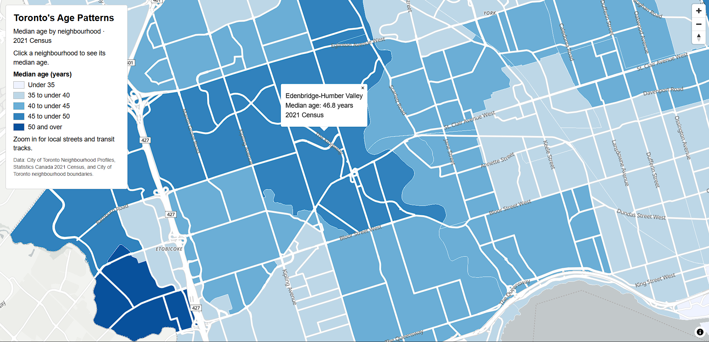

Toronto neighbourhood median age map using 2021 Census data.

I designed Toronto’s Age Patterns for students and residents interested in neighbourhood demographics as well as prospective residents comparing places to live. I chose this topic as I am from the Edenbridge-Humber Valley neighborhood and wanted to search its median age, so I centred the opening view there while allowing users to explore all of Toronto. More in depth, I was interested in how age patterns reflect the city’s development history with differences between established residential neighbourhoods and downtown areas. A pattern that I noticed was Edenbridge-Humber Valley’s relatively high median age of 46.8 years, compared with the younger populations in several central downtown neighbourhoods. Markland Wood and Rosedale-Moore Park also had notably high median ages. These findings made me think whether housing types, costs and residents remaining in their neighbourhoods as they age explain the pattern. I did have to keep in mind that median age alone doesn’t establish where retirees concentrate, or directly measure urban sprawl.

I aimed for a simple map that would be easily interpretable as that is the best I could do for now. I modified the positron style and used a sequential blue colour scheme. Increasing colour lightness represents lower median ages and darker shades representing higher values. Blue felt appropriate because of its association with Toronto’s visual identity. Five intervals separated at ages 35, 40, 45 and 50 provided straightforward thresholds without requiring readers to distinguish many shades. This classification simplifies comparison but it hides differences within each class. White neighbourhood outlines help separate adjacent areas with similar values. I placed the age layer above background features such as buildings and land cover, and drew roads, transit tracks and labels above it. This layer order preserves legibility and provides familiar reference points. I retained transport to aid readers to locate neighbourhoods and explore their relationship to transport corridors. Transit tracks can procure questions about connections between younger neighbourhoods and transport provision. They do not independently measure accessibility.

I used scale-dependent generalization to keep the map meaningful at different zoom levels. The citywide view emphasizes broad age patterns and major roads, local streets and their labels appear from zoom 13, and paths and transit tracks become available from zoom 14. Click popups provide neighbourhood names and precise median ages without permanently crowding the map with additional labels. Together, these choices make the map useful for both broad comparison and closer exploration. I am satisfied that the result communicates age differences clearly, although the 2021 Census data represent one point in time and neighbourhood medians conceal variation among residents. Future improvements would include housing costs and housing types to investigate possible explanations for the patterns. I would also like a time slider using comparable census years, with consistent neighbourhood boundaries, to show demographic change rather than implying that annual neighbourhood data are available.

I asked a classmate and a friend to look at my map. They found that the title, census year and labelled age intervals made its purpose and data easy to understand. They also liked the click popups and the additional detail available when zooming in. Their feedback reinforced my decision to retain the sequential blue palette and five age classes. Also keeping transport features visually secondary to the neighbourhood colours. They suggested examining the data distribution and comparing alternative classifications, such as quantiles or natural breaks. I retained the rounded thresholds for their straightforward interpretation, but ultimately would consider testing those alternatives in a future revision. I used Google to locate sources, the assignment’s HTML template as my starting point and the provided Maputnik tutorial video to learn the interface. I also consulted Maplibre examples and references covering GeoJson, data driven styling, layer ordering, popups, cursor changes and map overlays in tangent to MDN web docs responsive design guidance, MapTiler’s choropleth tutorial, and Protomaps documentation. Google notebooklm helped me figure out what data I would have to look for in order to make this map possible (csv, xlsx, json files etc...).

Map Link: https://ubc-geos472-fall2026.github.io/Swify7-web/toronto-age-map/
